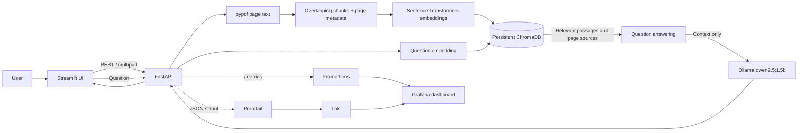

# Enterprise AI Knowledge Assistant

A local-first document assistant for searching and asking questions about enterprise PDFs. It uses FastAPI for the API, Streamlit for the web application, Sentence Transformers for embeddings, ChromaDB for persistent semantic search, and Ollama (`qwen2.5:1.5b`) for answers grounded in retrieved document excerpts. Docker Compose also starts Prometheus, Grafana, Loki, and Promtail.

> **Scope:** this repository contains a working local application and deployment configuration. A live Kubernetes rollout or GitHub Actions run is not claimed unless you perform the verification steps below.

## Problem statement

Important policies, procedures, and reference information often live in long PDF files. This project indexes searchable PDF text once, lets users ask natural-language questions, retrieves the closest passages by semantic similarity, and shows the cited file and page. The language model is instructed to use the retrieved context only; if retrieval finds no sufficiently relevant passage, the API returns a clear no-evidence answer without calling the model.

## Features

- Professional Streamlit interface with PDF upload, document list/removal, chat-style questions, and source excerpts.
- FastAPI endpoints for upload, question answering, document management, health checks, and Prometheus metrics.
- PDF type/size checks, page-by-page extraction, scanned/empty document handling, configurable overlapping chunks, and duplicate-content detection.
- Local Sentence Transformers embeddings and ChromaDB cosine-similarity search.
- Ollama-generated answers with a local `qwen2.5:1.5b` model; no paid API key.
- Persistent ChromaDB, embedding-model, and Ollama-model data in Docker volumes.
- Structured JSON application logs, Prometheus metrics, provisioned Grafana dashboard, and Loki log aggregation.
- Kubernetes manifests, an optional in-cluster Ollama deployment, CI tests/image build, and opt-in cluster deployment.

## Technology choices

| Component | Choice | Reason |
|---|---|---|
| UI | Streamlit | Fast Python UI with upload and chat interactions |
| API | FastAPI | Typed REST endpoints, validation, OpenAPI documentation |
| PDF processing | pypdf | Extract text while keeping page numbers |
| Chunking | Small local Python module | Explicit chunk size/overlap and page metadata |
| Embeddings | Sentence Transformers `all-MiniLM-L6-v2` | Local semantic vectors; no API key |
| Vector database | ChromaDB | Persistent local collection and cosine search |
| LLM | Ollama `qwen2.5:1.5b` | Local answer generation, no paid inference service |
| Monitoring/logging | Prometheus, Grafana, Loki, Promtail | Metrics and centralized container/pod logs |

LangChain is not required: the small RAG orchestration is implemented directly so retrieval, model calls, and error handling are easy to follow.

## Architecture



### RAG workflow

1. The UI sends a PDF to `POST /upload`; the API checks the extension, PDF signature, and configured size limit.
2. `backend/pdf_processing.py` extracts text separately for each page. Invalid, encrypted, and text-empty/scanned files receive actionable errors.
3. `backend/chunking.py` normalizes whitespace and splits page text into 900-character passages with 150-character overlap. Every passage retains its filename, page number, and chunk index.
4. `backend/embeddings.py` lazily loads `sentence-transformers/all-MiniLM-L6-v2` and creates normalized vectors locally.
5. `backend/vector_store.py` stores vectors, text, file hash, and source metadata in a persistent ChromaDB collection.
6. `POST /ask` embeds the question, performs cosine-similarity search, and discards results beyond `RELEVANCE_DISTANCE_THRESHOLD`.
7. `backend/llm.py` sends the question and retrieved passages to Ollama. The prompt requires context-only answers and `[filename, p. N]` citations. No relevant passages means a deterministic no-evidence response and no LLM call.

### Module map

```text
backend/
  main.py                 FastAPI endpoints, metrics, request logging
  config.py               Environment-based settings
  pdf_processing.py       PDF validation and page extraction
  chunking.py             Overlapping text chunks
  embeddings.py            Local Sentence Transformers adapter
  vector_store.py          Persistent ChromaDB operations
  llm.py                   Ollama API client and grounded prompt
  question_answering.py    Retrieval threshold and answer orchestration
frontend/
  streamlit_app.py         Streamlit upload, document list, and chat UI
tests/
  test_backend.py          API, PDF, embedding adapter, and Chroma tests
kubernetes/                Application, Ollama, storage, and monitoring manifests
monitoring/
  prometheus/              Scrape configuration
  grafana/                 Datasources and dashboard
  loki/                    Loki and Promtail configuration
.github/workflows/         Tests, Docker build/publish, optional Kubernetes rollout
```

## Prerequisites

- Python 3.11 or newer (Python 3.12 is the tested Docker/CI version).
- Docker Desktop using its Linux container engine and Docker Compose v2.
- Internet access on first startup to download the container images, embedding model, and Ollama model.
- Recommended for the full Compose stack: 8 GB or more available RAM and several GB of free disk space. Ollama runs on CPU by default; first answer generation may take time.

## Local Python execution

Install Ollama separately if you want to run the API/UI directly on the host. Start the Ollama service and download the model once:

```powershell
ollama pull qwen2.5:1.5b
```

In the project directory, create and activate a Python environment:

```powershell
py -3.12 -m venv .venv
.\.venv\Scripts\Activate.ps1
python -m pip install --upgrade pip
python -m pip install -r requirements-dev.txt
```

Run the API and frontend in two terminals. Set the same Ollama URL in the API terminal:

```powershell
$env:CHROMA_PATH = "$PWD\data\chroma"
$env:OLLAMA_URL = "http://localhost:11434"
$env:OLLAMA_MODEL = "qwen2.5:1.5b"
python -m uvicorn backend.main:app --host 127.0.0.1 --port 8000
```

```powershell
.\.venv\Scripts\Activate.ps1
$env:API_URL = "http://127.0.0.1:8000"
python -m streamlit run frontend/streamlit_app.py
```

Open [http://localhost:8501](http://localhost:8501). FastAPI docs are at [http://localhost:8000/docs](http://localhost:8000/docs). If PowerShell blocks venv activation, run `Set-ExecutionPolicy -Scope Process -ExecutionPolicy Bypass` in that terminal and activate again.

## Docker Compose (recommended)

Docker Desktop must be running with the **Linux** engine. Start from the repository root:

```powershell
Copy-Item .env.example .env
notepad .env
docker compose up --build -d
docker compose ps
```

Change `GRAFANA_PASSWORD` in `.env` before sharing the machine or dashboard. The first run builds the Python image, downloads the embedding model when the first PDF is indexed, downloads `qwen2.5:1.5b` through `ollama-model-init`, and starts the services. Model downloads can take several minutes.

Useful URLs:

| Service | Address | Purpose |
|---|---|---|
| Streamlit UI | [http://localhost:8501](http://localhost:8501) | Upload PDFs and ask questions |
| FastAPI docs | [http://localhost:8000/docs](http://localhost:8000/docs) | Exercise the REST API |
| API health | [http://localhost:8000/health](http://localhost:8000/health) | Liveness |
| API readiness | [http://localhost:8000/ready](http://localhost:8000/ready) | ChromaDB readiness |
| Prometheus | [http://localhost:9090](http://localhost:9090) | Targets and metrics queries |
| Grafana | [http://localhost:3000](http://localhost:3000) | Dashboard and log search |
| Loki API | [http://localhost:3100/ready](http://localhost:3100/ready) | Loki readiness |

Grafana login defaults to `admin`; the password is `GRAFANA_PASSWORD` in `.env` (the development fallback is `change-me`). The dashboard **Enterprise AI Knowledge Assistant** is provisioned automatically.

Verify API, Prometheus, and Loki from PowerShell:

```powershell
Invoke-RestMethod http://localhost:8000/health
Invoke-RestMethod http://localhost:8000/ready
Invoke-RestMethod "http://localhost:9090/api/v1/query?query=up"
Invoke-WebRequest http://localhost:3100/ready
docker compose logs --tail 50 backend
```

In Grafana, open **Explore → Loki** and run `{container=~".*backend.*"}`. Generate activity by opening the UI, uploading a PDF, or asking a question. The Promtail container discovers Docker containers via the Docker socket. On Docker Desktop, if Promtail cannot see logs, check `docker compose logs promtail`, ensure the Linux Docker engine is running, and confirm the Docker socket is available to containers. You can always inspect application stdout with `docker compose logs backend`.

Stop the stack without deleting indexed PDFs, vectors, models, or monitoring data:

```powershell
docker compose down
```

Remove all persistent volumes only when you intentionally want to erase the local data:

```powershell
docker compose down --volumes
```

### Storage and important design decisions

- `chroma-data` persists PDF text chunks, embeddings, filenames, hashes, and page numbers.
- `embedding-model-cache` keeps the Sentence Transformers model between container restarts.
- `ollama-data` stores the local LLM and survives model-service restarts.
- Prometheus, Loki, and Grafana each have named persistent volumes.
- Identical PDF bytes are indexed once by SHA-256, even if uploaded with another name.
- The vector store is local and single-instance; scaling the API to multiple replicas requires a shared vector database and coordinated ingestion.
- The application has no login or tenant isolation. Do not expose it to untrusted users or ingest confidential documents without adding access controls and an approved data-handling policy.

## Kubernetes

`kubernetes/` contains the Streamlit and FastAPI deployments/services, ConfigMap, persistent volume claims, an Ollama deployment with a model-download init container, Prometheus, Grafana, Loki, and a Promtail DaemonSet. Ollama runs **inside the cluster** and the API connects to `http://ollama:11434`; it does not depend on `localhost` referring to the host.

### Docker Desktop Kubernetes

Enable Kubernetes in Docker Desktop settings and wait until `kubectl config current-context` succeeds. Build the image into Docker Desktop's local image store and apply the root Kustomize overlay:

```powershell
docker build -t enterprise-ai-knowledge-assistant:local .
kubectl config current-context
kubectl apply -k .
```

Create the Grafana admin Secret before its pod starts. The deployment will retry while the Secret is absent:

```powershell
kubectl create namespace knowledge-assistant --dry-run=client -o yaml | kubectl apply -f -
kubectl create secret generic grafana-admin -n knowledge-assistant `
  --from-literal=password="replace-with-a-strong-password" `
  --dry-run=client -o yaml | kubectl apply -f -
kubectl apply -k .
```

For **kind**, load the built image first with `kind load docker-image enterprise-ai-knowledge-assistant:local`. For **minikube**, use `minikube image load enterprise-ai-knowledge-assistant:local`. This avoids Kubernetes trying to pull a laptop-only development image from a public registry.

Verify rollout and access the app:

```powershell
kubectl get pods -n knowledge-assistant -w
kubectl rollout status deployment/backend -n knowledge-assistant --timeout=15m
kubectl rollout status deployment/frontend -n knowledge-assistant --timeout=5m
kubectl rollout status deployment/ollama -n knowledge-assistant --timeout=15m
kubectl port-forward -n knowledge-assistant svc/frontend 8501:8501
```

Open [http://localhost:8501](http://localhost:8501). In another terminal, open Grafana with `kubectl port-forward -n knowledge-assistant svc/grafana 3000:3000`; use `admin` and the Kubernetes Secret password. The cluster needs a default storage class and enough memory/CPU for Chroma, the embedding model, observability services, and Ollama. Model download happens in the Ollama init container and can delay that deployment's readiness.

To publish to a **private** GHCR package for a remote cluster, create a `ghcr-pull` Secret with a GitHub token that has `read:packages` permission and attach it to the namespace's default ServiceAccount. The GitHub workflow does this when it is configured for deployment. Replace the sample Kustomize image in `kubernetes/deployment.yaml` only when deploying manually to a registry.

The Kubernetes manifests are a single-node assessment example. Loki uses a single replica, and Promtail needs root/read access to node pod logs. For production, review RBAC/hostPath access, retention, TLS/ingress, authentication, backup/restore, resource sizing, storage class, network policies, model governance, and high availability.

## Monitoring and centralized logging

### Prometheus and Grafana

Prometheus scrapes `/metrics` on the backend every 15 seconds. The dashboard includes:

- Total request count for the selected time range and HTTP request rate/status.
- 95th-percentile API latency.
- HTTP 5xx error percentage.
- Application process CPU, resident memory, and uptime metrics.
- Backend JSON logs from Loki.

The API defines `http_requests_total`, `http_request_duration_seconds`, `application_uptime_seconds`, `process_cpu_percent`, and `process_memory_bytes`. CPU/memory describe the Python process; container/node metrics are not claimed. In Grafana, check **Connections → Data sources** and verify Prometheus and Loki are healthy.

### Loki logs

The application writes structured JSON request and lifecycle logs to stdout. Promtail discovers Docker logs in Compose and Kubernetes pod logs in the cluster and ships them to Loki. In Grafana Explore, select Loki and query:

```logql
{container=~".*backend.*"}
```

Use the **level** or **logger** labels to narrow the results. Confirm ingestion with `docker compose logs promtail` and by issuing an API request. Loki is not exposed with authentication by this development Compose stack; keep it on a trusted local machine.

## CI/CD

`.github/workflows/ci-cd.yml` runs for pull requests and pushes to `main`:

1. Installs the lightweight Python 3.12 test dependencies, compiles modules, runs tests, and renders the Kubernetes manifests.
2. Builds the Docker image for PRs; on `main`, publishes `ghcr.io/<owner>/<repository>:<commit-sha>` using the built-in `GITHUB_TOKEN`.
3. Only deploys to Kubernetes when the repository variable `ENABLE_K8S_DEPLOY` is set to `true`.

For deployment, configure repository secrets:

- `KUBE_CONFIG`: base64-encoded kubeconfig for a restricted deployment identity.
- `GRAFANA_ADMIN_PASSWORD`: strong dashboard password.
- `GHCR_PULL_TOKEN`: GitHub token with `read:packages` for the cluster to pull the published image.

The workflow replaces the local image tag, creates the Grafana and GHCR pull Secrets, applies `kubectl apply -k .`, and checks the rollout. Without the deployment variable and secrets, no cluster deployment runs. Review GitHub environment protections and cluster RBAC before enabling it.

## Tests

Use Python 3.12 for the same environment as CI:

```powershell
py -3.12 -m venv .venv
.\.venv\Scripts\Activate.ps1
python -m pip install -r requirements-test.txt
python -m pytest -q
```

Tests cover PDF extraction/error handling, page-aware chunking, the embedding adapter, persistent ChromaDB similarity/restart behavior, upload validation, duplicate detection, question citations, the relevance threshold, Ollama failure reporting, health/readiness, and metrics. The embedding adapter and Ollama are mocked in API tests; the ChromaDB persistence test uses a real temporary local database, so tests require no model download or paid API.

## Screenshots

No screenshots are checked into the repository yet. Suggested assessment captures:

1. `screenshots/assistant-home.png`: clean Streamlit start screen.
2. `screenshots/answer-with-sources.png`: answer and expanded PDF/page citations.
3. `screenshots/grafana-dashboard.png`: request, latency, error, CPU, and memory panels.
4. `screenshots/grafana-logs.png`: Loki Explore results after a question request.

Capture the screens after starting the stack so they show live results, not mock data.

## Troubleshooting

| Symptom | Check / fix |
|---|---|
| Docker pipe/daemon connection error | Start Docker Desktop, select the Linux engine, wait for the engine to become ready, then retry `docker info`. |
| Port 8000/8501/3000 already in use | Stop the other app or change the corresponding host port mapping in `docker-compose.yml`. |
| First `docker compose up` appears slow | Image builds and first-time embedding/Ollama model downloads take time. Watch `docker compose logs -f ollama-model-init backend`. |
| `ollama-model-init` fails | Check network access and `docker compose logs ollama ollama-model-init`; restart with `docker compose up -d ollama ollama-model-init`. |
| API reports Ollama unavailable | `docker compose ps`; verify Ollama and model initialization, then inspect `docker compose exec ollama ollama list`. |
| First PDF upload is slow | The local Sentence Transformers model is downloaded and cached on the first indexing request. |
| No text found in PDF | Current ingestion extracts embedded text only; OCR the scanned file before upload. |
| Question has no answer | Check that indexed passages discuss the topic and adjust `RELEVANCE_DISTANCE_THRESHOLD` only after review. |
| Grafana panels say no data | Generate API requests, check the Prometheus target at `/targets`, and verify source UIDs in Grafana. |
| Loki Explore is empty | Inspect `promtail` logs, Docker socket access, and the query label; `docker compose logs backend` confirms stdout regardless. |
| Kubernetes PVC stays Pending | Enable the cluster's default storage class or configure an appropriate storage provisioner. |
| Kubernetes image pull fails | For local clusters, load the local image; for private GHCR, create `ghcr-pull` with `read:packages`. |
| Kubernetes Ollama stays initializing | Model download requires network and storage; inspect `kubectl logs -n knowledge-assistant deploy/ollama -c download-model`. |
| PowerShell activation is blocked | Run `Set-ExecutionPolicy -Scope Process -ExecutionPolicy Bypass` in that terminal, then activate the venv. |
